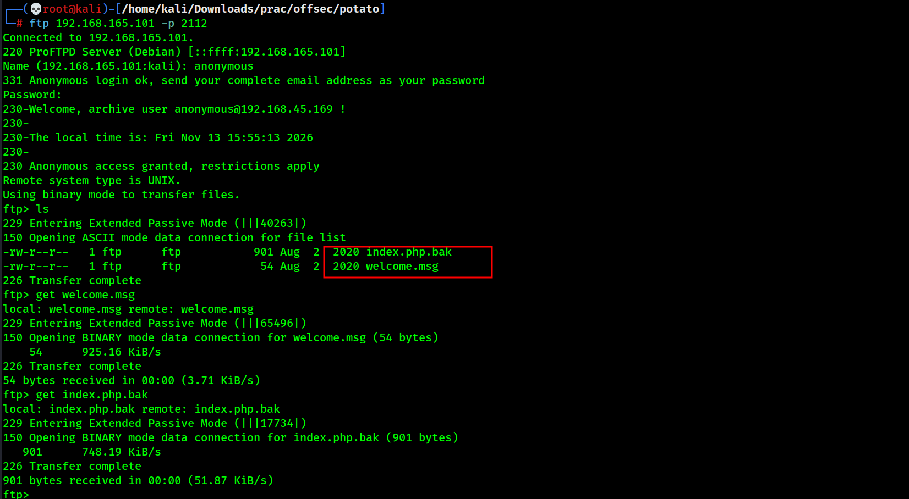

# Potato

## Enumeration&#x20;

### Nmap scan&#x20;

```
PORT     STATE SERVICE REASON         VERSION
22/tcp   open  ssh     syn-ack ttl 61 OpenSSH 8.2p1 Ubuntu 4ubuntu0.1 (Ubuntu Linux; protocol 2.0)
| ssh-hostkey: 
|   3072 b5:e7:70:5f:4b:20:42:51:eb:b6:18:de:95:15:ca:73 (RSA)
| ssh-rsa AAAAB3NzaC1yc2EAAAADAQABAAABgQDdQd4IL87YgVKb/ojNlB7j5JLffKd9pd+U7wWmZfWYGBqL7lbSLLUV6dDfEVUOB/Pa/qFZAkaU1trqPnzHoemZDNfrGTcDEyMUFCo/ckFkkE+t6Sv2poj1HiDvFvH9oka2St2e5bGDjz68y5Lwb6UvLxA355a2LQV1nIUM577erDWbViLScweWh+rIkz5eB8rzwmoLU7HnGhPby0uHQA3rkJUb8Nng3Zkzvt4nzSpdO0sItkzSFlXvGs8AAQP1XeWDZvaOQh1fC58Taz1YZ79WFuIvj7w8sXxTeYlM7/TqfTp6rjVCCB4LUu2MvC77/36u6to18rRvkZzp8aLAMg2C9g0owQt+VvpxHAesMJDmc4ZlfKJ7HP9ucWbGpQSWhSSoelC/7+NSSveGzGdV1i9C/3yIObHh6kco15CQThsuE1a4yZgDQINw+dxJsc1pDHon6IfVXw6jib993s8Sg6AdsibxhYmU44cZfC4w6mUzOLah31zRHoibhKPM+QQjzb0=
|   256 ae:04:71:9d:8b:46:b8:3f:91:a7:a5:99:50:c4:38:0d (ECDSA)
| ecdsa-sha2-nistp256 AAAAE2VjZHNhLXNoYTItbmlzdHAyNTYAAAAIbmlzdHAyNTYAAABBBEt1qejXtGccJfgHK7mIrdJe2JinVrQDZc/BRjYDTuDpPwnIuYPTEQYjmHAAXVU5oHgpOJ/WAGcrDkVYLHA7fno=
|   256 2c:a5:49:be:1c:91:ec:77:1f:b4:28:9c:89:08:55:6c (ED25519)
|_ssh-ed25519 AAAAC3NzaC1lZDI1NTE5AAAAIH1QlizWokFWBE7dF9Q29Tv+5FlOrIxufMIUTxZWobSu
80/tcp   open  http    syn-ack ttl 61 Apache httpd 2.4.41 ((Ubuntu))
| http-methods: 
|_  Supported Methods: GET HEAD POST OPTIONS
|_http-title: Potato company
|_http-server-header: Apache/2.4.41 (Ubuntu)
2112/tcp open  ftp     syn-ack ttl 61 ProFTPD
| ftp-anon: Anonymous FTP login allowed (FTP code 230)
| -rw-r--r--   1 ftp      ftp           901 Aug  2  2020 index.php.bak
|_-rw-r--r--   1 ftp      ftp            54 Aug  2  2020 welcome.msg
Warning: OSScan results may be unreliable because we could not find at least 1 open and 1 closed port
OS fingerprint not ideal because: Missing a closed TCP port so results incomplete
Aggressive OS guesses: Linux 2.6.32 - 3.13 (96%), Linux 5.0 - 5.14 (96%), Linux 3.2 - 4.14 (96%), Linux 4.15 - 5.19 (96%), Linux 2.6.32 - 3.10 (96%), Linux 4.15 (95%), Linux 5.14 - 6.8 (95%), Linux 3.10 - 4.11 (94%), Linux 2.6.32 - 3.5 (93%), HP P2000 G3 NAS device (93%)
No exact OS matches for host (test conditions non-ideal).
TCP/IP fingerprint:
```


### Port 2112 - FTP&#x20;

Anonymous login is allowed and able to download two files&#x20;

<figure><figcaption></figcaption></figure>

The login mechanism is vulnerable to PHP type juggling due to the loose comparison (== 0) used with strcmp(). In PHP versions prior to 8.0, submitting an array parameter (password\[]=) instead of a string causes strcmp() to return NULL. Because PHP loosely evaluates NULL == 0 as true, authentication is bypassed without knowing the password, which also sets the valid password cookie in the response.

<figure><figcaption></figcaption></figure>


### Port 80 - HTTP

Directory brute-forcing revealed an `/admin` endpoint hosting a login portal. Reviewing `index.php.bak`, which was previously retrieved from the FTP server, exposed the underlying authentication logic and a PHP type-juggling vulnerability that allowed bypassing the login check.

<figure><figcaption></figcaption></figure>

<figure><figcaption></figcaption></figure>

<figure><figcaption></figcaption></figure>

Upon bypassing the login check, the server issued a `pass` cookie containing the valid administrative password. Setting this cookie in the browser session granted authenticated access to `/admin/index.php`

<figure><figcaption></figcaption></figure>

Intercepting the logs revealed a `file` parameter used to fetch local resources. Testing confirmed a Local File Inclusion (LFI) vulnerability, allowing me to fuzz paths and retrieve `/etc/passwd`, which exposed a webadmin user's password hash.

<figure><figcaption></figcaption></figure>

<figure><figcaption></figcaption></figure>

<figure><figcaption></figcaption></figure>

Using John the Ripper, I cracked the extracted hash to recover the user's plaintext password. With these valid credentials, I authenticated via SSH (port 22) to gain initial access to the target machine


### Port 22 - SSH

<figure><figcaption></figcaption></figure>

### Privilege Escalation&#x20;

Running sudo -l revealed that webadmin could execute /bin/nice /notes/\* as root. Because nice executes whatever binary is passed as an argument and the wildcard (\*) allows path traversal, I executed sudo /bin/nice /notes/../bin/bash to spawn a root shell and retrieve the final flag

```
Command:- sudo /bin/nice /notes/../bin/sh
```

<figure><figcaption></figcaption></figure>


